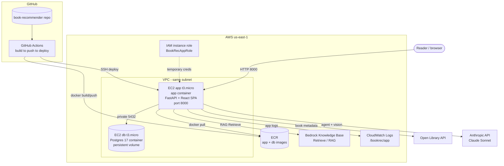

# Book Recommender

An AI book-recommendation app: a reader submits their taste (free text + an optional
**bookshelf photo**); an **agent** researches a catalog and a **Bedrock Knowledge
Base**, validates every pick against the catalog, and returns a shortlist with
visible uncertainty. Built for the AI course capstone.

See [`DESIGN.md`](DESIGN.md) for the full concept/architecture, [`OPEN_QUESTIONS.md`](OPEN_QUESTIONS.md)
for open decisions, and [`COST.md`](COST.md) for the cost estimate + teardown.

> **Secrets:** this README uses **placeholders only** (`<ACCOUNT_ID>`, `<...>`). Real
> keys, passwords, and `.env` files are never committed — they live in GitHub Actions
> secrets and in untracked env files on the servers.

---

## Use cases

The app supports the full "find your next book" loop:

- **Browse the catalog** — search and filter books by title, author, or genre (public, no sign-in).
- **Accounts** — sign up / sign in with email + password (HTTP-only session cookie).
- **Shelves (your library)** — create named shelves, add/remove books, plus a built-in **Exclusion** shelf whose books are never recommended and never count as taste.
- **Ratings & reviews** — rate a book and write a short review, independent of shelves.
- **Bookshelf-photo import** — upload a photo of a shelf; Claude vision reads the spines, matches them to the catalog, and you confirm which to add. The image is processed **in memory** and never stored.
- **Shelf recommendations** — "Get recommendation" seeded by one shelf or your whole library: results are clustered and tagged by cluster and whether they are *exploratory*; Exclusion-shelf hits are flagged rather than shown as picks.
- **"What's my next read?" assistant** — describe your mood/taste in free text; a tool-using agent finds real catalog books, excludes what you already have, asks one clarifying question when the request is too vague, and abstains instead of padding weak picks. A per-user daily request quota applies.
- **Find similar** — on any book page, retrieve similar books from the Bedrock Knowledge Base, each with a grounding snippet and its source.

---

## Architecture



**Key points**
- **One container serves the whole app** (JSON API under `/api/*` **and** the React SPA) on port 8000.
- **App and DB run on separate EC2 instances** in the same VPC; the app reaches the DB over its **private IP** on 5432 (never exposed publicly).
- **AWS access is keyless on the box** — the app gets temporary credentials from the **IAM instance role** (`BookRecAppRole`: Bedrock Retrieve, CloudWatch Logs, ECR read). No AWS keys are stored on the servers.
- **LLM calls go to the Anthropic API** (Claude Sonnet, agent + vision); **Bedrock** is used only for the Knowledge Base retrieval (RAG).

---

## Tech stack

| Layer | Choice |
|-------|--------|
| Backend | Python 3.12, **FastAPI** + uvicorn |
| Frontend | **React** SPA (no-build; ES modules + import map), served by FastAPI |
| Agent / vision | **Claude Sonnet** via the Anthropic SDK |
| RAG | **Amazon Bedrock Knowledge Base** (`Retrieve`) via boto3 |
| Graph tools | **LangGraph** (inside `parse_bookshelf` and `find_similar_by_bookshelf` only) |
| Database | **PostgreSQL 17** (containerised) |
| Book metadata | Open Library API |
| Packaging / deploy | Docker, **Amazon ECR**, **EC2**, **GitHub Actions** |
| Ops | CloudWatch Logs, IAM instance role, security groups |

---

## Repository layout

```
app/          FastAPI backend + agent + tools + React SPA (static/)  + Dockerfile
db/           SQL schema, migrations, seed, migration runner
.github/workflows/deploy.yml   CI/CD: build -> ECR -> deploy to EC2
docker-compose.yml             LOCAL DEV ONLY (app + Postgres)
DESIGN.md  OPEN_QUESTIONS.md  COST.md  STYLE.md
```

---

## Local development

Runs the app + Postgres with Docker Compose.

```bash
cp .env.example .env            # POSTGRES_USER/PASSWORD/DB/PORT, APP_PORT
cp app/.env.example app/.env    # ANTHROPIC_API_KEY, BEDROCK_KB_ID, ... (never commit)
docker compose up -d --build    # db + app  ->  http://localhost:8000
```

First run applies `db/init/`. A demo account is seeded (see [`app/README.md`](app/README.md)).
To run uvicorn on the host instead, start just the DB: `docker compose up -d db`.

---

## Deployment (AWS)

### Prerequisites (one-time)
- Two **ECR** repositories: `gde-aliaksandrsh-br-be` (app), `gde-aliaksandrsh-br-db` (db).
- A **Bedrock Knowledge Base** (its id → `BEDROCK_KB_ID`).
- Two **EC2** instances (x86_64, Ubuntu) in the **same VPC/subnet**: one app, one db.
- Security groups:
  - app: inbound **8000** from clients, **22** from your IP.
  - db: inbound **5432 from the app's security group only**, **22** from your IP.
- An **IAM instance role** (`BookRecAppRole`) attached to the app instance, with:
  `AmazonEC2ContainerRegistryReadOnly`, plus inline **`bedrock:Retrieve`** (your KB) and
  **CloudWatch Logs write** (`/bookrec/app`). Set the instance **IMDS hop limit to 2**
  so the container can read the role.
- A **CloudWatch Logs** group `/bookrec/app`.

### Build & push images (first time / manually)
```bash
aws ecr get-login-password --region us-east-1 \
  | docker login --username AWS --password-stdin <ACCOUNT_ID>.dkr.ecr.us-east-1.amazonaws.com
docker build -t <ACCOUNT_ID>.dkr.ecr.us-east-1.amazonaws.com/gde-aliaksandrsh-br-be:latest ./app
docker push   <ACCOUNT_ID>.dkr.ecr.us-east-1.amazonaws.com/gde-aliaksandrsh-br-be:latest
```

### Bootstrap the servers (first time)
On each EC2 box (`ubuntu@...`): install Docker, then place the runtime env **files**
(these hold secrets and are **not** in the repo):
- `/home/ubuntu/db.env` → `POSTGRES_USER`, `POSTGRES_PASSWORD`, `POSTGRES_DB`
- `/home/ubuntu/app.env` → `ANTHROPIC_API_KEY`, `BEDROCK_KB_ID`, `SESSION_SECRET`

**DB box** — run Postgres with a persistent volume and the schema/seed, then migrations:
```bash
docker run -d --name db --restart unless-stopped --env-file /home/ubuntu/db.env \
  -v pgdata:/var/lib/postgresql/data \
  -v /home/ubuntu/init:/docker-entrypoint-initdb.d:ro -p 5432:5432 \
  <ACCOUNT_ID>.dkr.ecr.us-east-1.amazonaws.com/gde-aliaksandrsh-br-db:latest
# then apply db/migrations via db/migrate.py against this database
```

**App box** — run the app pointing at the DB's **private** IP (no AWS keys needed; the
instance role supplies them):
```bash
docker run -d --name app --restart unless-stopped --env-file /home/ubuntu/app.env \
  -e DATABASE_URL="postgresql://<user>:<password>@<DB_PRIVATE_IP>:5432/<db>" \
  -e AWS_REGION=us-east-1 \
  -e CLOUDWATCH_LOG_GROUP=/bookrec/app -e CLOUDWATCH_LOG_STREAM=app \
  -p 8000:8000 \
  <ACCOUNT_ID>.dkr.ecr.us-east-1.amazonaws.com/gde-aliaksandrsh-br-be:latest
```
Open `http://<app-public-ip>:8000/`.

### Continuous deployment (GitHub Actions)
Pushing to `main` (changes under `app/**` or the workflow) runs
[`.github/workflows/deploy.yml`](.github/workflows/deploy.yml): **build the image →
push to ECR → SSH to the app EC2 → pull & restart the container**. The box stays
keyless — the runner generates a short-lived ECR login token for the pull, and the
running app uses the instance role for Bedrock/CloudWatch.

Required **GitHub Actions secrets** (Settings → Secrets and variables → Actions) —
names only; set the values in the GitHub UI:

| Secret | Purpose |
|--------|---------|
| `AWS_ACCESS_KEY_ID` / `AWS_SECRET_ACCESS_KEY` | runner pushes the image to ECR |
| `EC2_HOST` | app instance public IP/DNS (use an Elastic IP so it is stable) |
| `EC2_SSH_KEY` | private key to SSH into the app instance |

> The app's own runtime secrets (`ANTHROPIC_API_KEY`, `DATABASE_URL`, `SESSION_SECRET`)
> stay in `/home/ubuntu/app.env` on the box and are **not** passed through GitHub.

### Cost & teardown
See [`COST.md`](COST.md) — ~$24/month running 24/7 (~$16 with the EC2 free tier);
stop the instances between demos to cut it to near zero. `COST.md` has the full
teardown commands (EC2, ECR, CloudWatch, IAM).

---

## Evaluation

### Prompt improvements
- **Anti-hallucination assistant prompt** ([`app/config.py`](app/config.py)): the "next read"
  agent is told to recommend **only real books found through tools**, never invent a
  title/author/ISBN, **exclude the reader's shelves** (and never suggest Exclusion-shelf
  books), **abstain or recommend fewer** when the tools find no good match, and **ask one
  short clarifying question** when the request is too vague instead of guessing. Every
  presented book is still verified against the catalog in code — unverified picks are dropped.
- **Cross-language spine reading** ([`app/tools/parse_bookshelf.py`](app/tools/parse_bookshelf.py)):
  the vision prompt emits a canonical **English `title_en`** plus the detected language and
  uses the language-stable **authors** as the match anchor, so a non-English spine still
  resolves to the right catalog book.
- **Eval-driven query simplification** ([`app/scripts/eval_bookshelf_query.py`](app/scripts/eval_bookshelf_query.py)):
  for shelf recommendations we **measured** an LLM-generated "blurb" query against a plain
  per-cluster query (LLM-judged precision@8 + run-to-run stability) and **replaced the LLM
  blurb with the plain query** — simpler, as accurate, and more stable.

### Known limitations
- **Recommendation rationale isn't cited yet.** The conversational recommendations' "why" is
  the agent's own reasoning; the dedicated grounding tool isn't wired into that flow (the
  book-page "Find similar" *does* carry KB snippets + sources). Citation enrichment is the
  planned RAG improvement.
- **Partial knowledge-base coverage** — the KB has review/guide passages for only a subset of
  books, so some recommendations have no grounding (surfaced, not hidden).
- **Bookshelf accuracy varies** — spine reading depends on photo quality; unreadable/unmatched
  spines are dropped and counted, never guessed.
- **Uploads are in-memory only** — bookshelf images are never persisted (S3 storage deferred by design).
- **No high availability** — one instance per tier; the app's public IP changes on stop/start (no Elastic IP).
- **Network hardening pending** — SSH (22) is still open to `0.0.0.0/0`.
- **LLM cost** — the agent/vision use the Anthropic API (usage-priced); the per-user
  **1,000/day** and global **1,000,000/day** request quotas cap exposure.
- **n8n outbound pipeline not implemented** (see below).

---

## n8n pipeline — **not implemented**

The design ([`DESIGN.md` §7](DESIGN.md)) includes an optional **outbound "find
interested readers" n8n pipeline** (given a book → find users who liked similar
books → email them via SES). **This flow is not implemented** — it is an optional
component of the brief and is left as future work. Everything described above (the
interactive recommendation app) is implemented and deployed.
